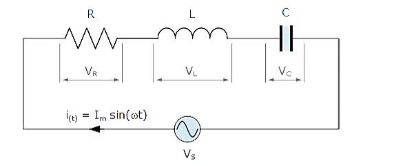

# Series RLC Circuit Simulation (MATLAB Simulink & App Designer)

An interactive engineering simulation tool that models the time-domain behavior of a driven **Series RLC circuit** by solving its governing integro-differential equations in **MATLAB Simulink**, paired with a custom GUI built in **MATLAB App Designer**.

## Mathematical Model
Applying Kirchhoff's Voltage Law (KVL) to the series RLC loop driven by a sinusoidal voltage source $V_s(t)$:

$$V_s(t) = R \cdot i(t) + L \frac{di(t)}{dt} + \frac{1}{C} \int i(t)\,dt$$

Rearranging for the current $i(t)$ implemented in the Simulink block diagram:

$$i(t) = \frac{1}{L} \int \left( V_s(t) - R \cdot i(t) - \frac{1}{C} \int i(t)\,dt \right) dt$$

## Key Features
* **Simulink Dynamic Model (`RLC_model_1.slx`):** Implements continuous-time integrators, gain blocks ($R$, $1/L$, $1/C$), feedback loops, and workspace logging (`To Workspace`).
* **Interactive App Designer GUI (`RLC_screen.mlapp`):** Allows real-time tuning of circuit parameters ($R$, $L$, $C$, and angular frequency $\omega_0$) and plots the resulting current waveform $i(t)$ without manually editing the block diagram.

## How to Run
1. Download `RLC_model_1.slx` and `RLC_screen.mlapp` into the same MATLAB working folder.
2. Open `RLC_screen.mlapp` in **MATLAB App Designer** and click **Run**.
